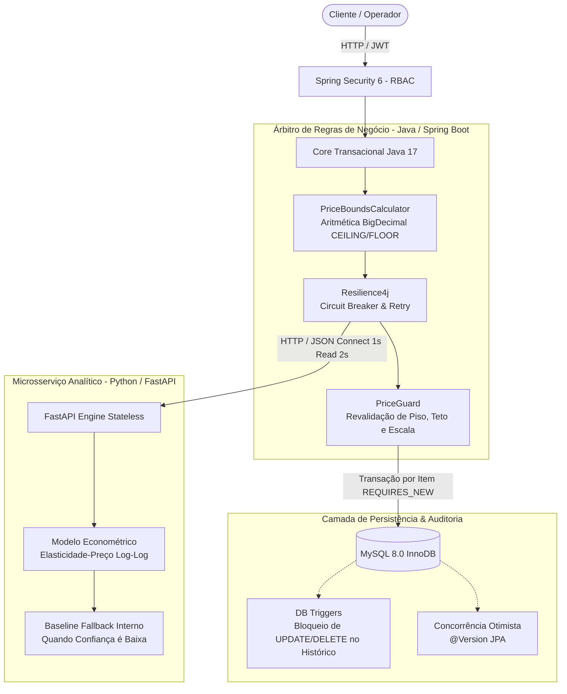
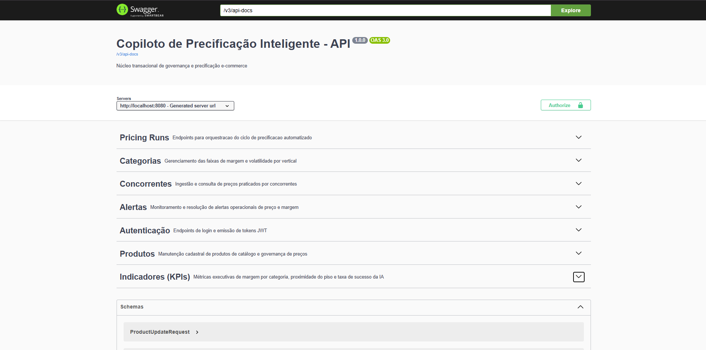
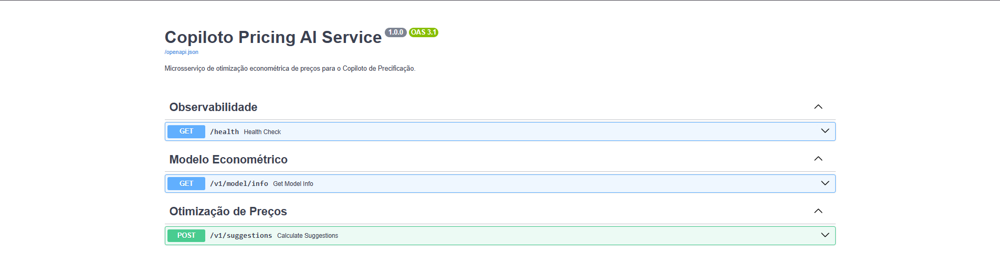
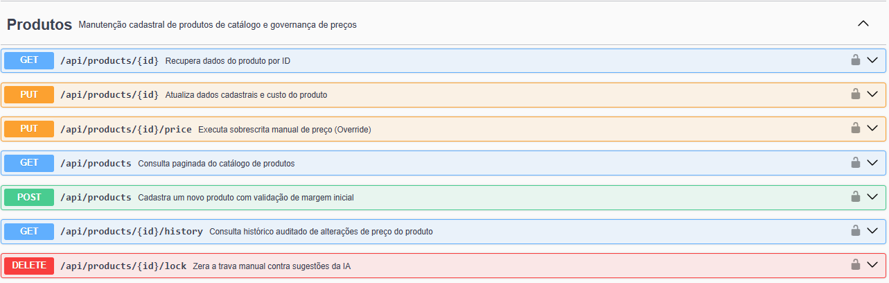
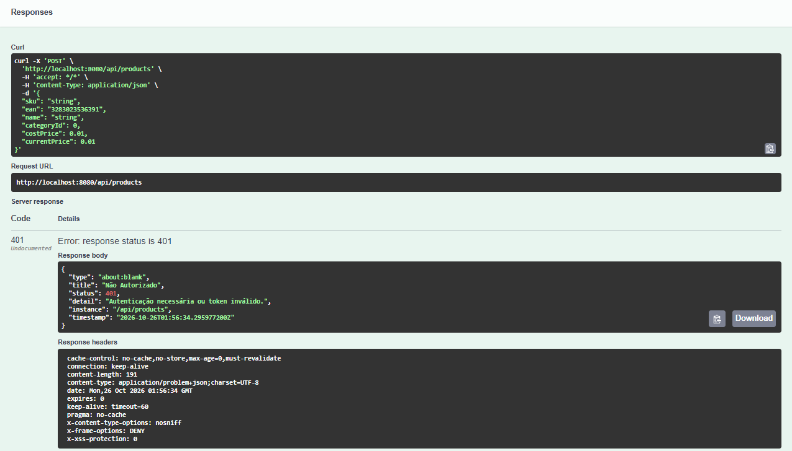
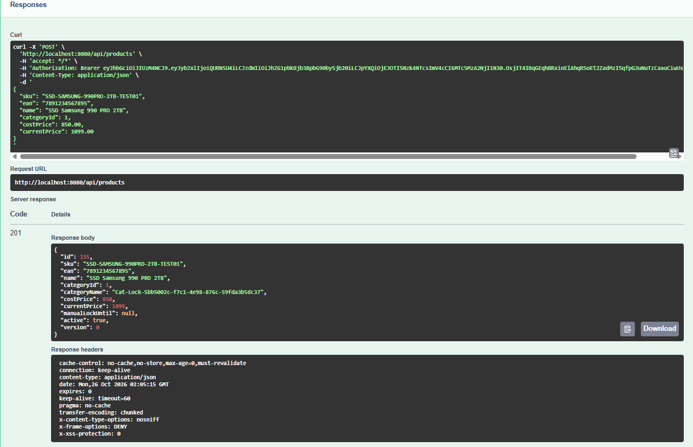
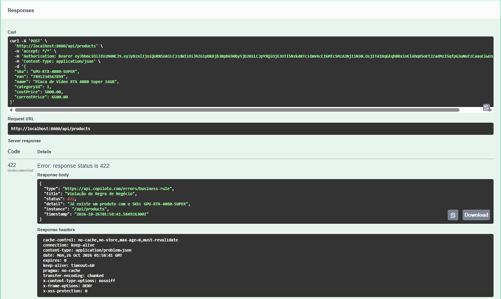
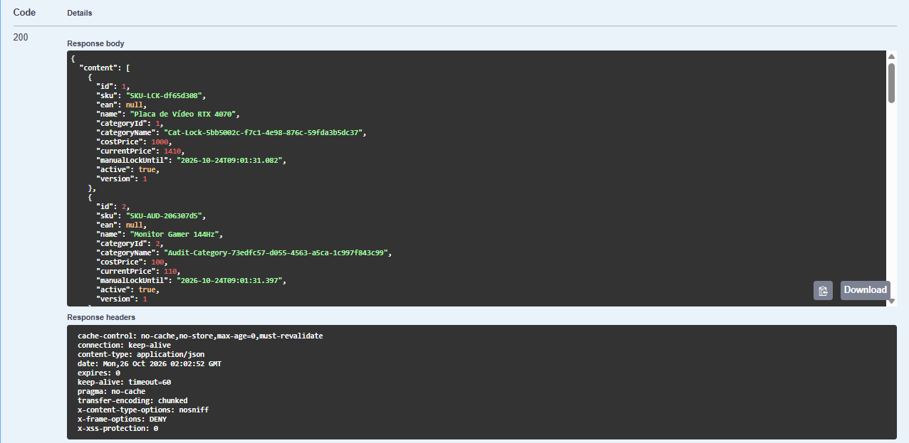

# Copiloto de Precificação Inteligente

<p align="left">
  
  
  
  
  
  
  
</p>

---

## O Problema & A Solução de Engenharia

No comércio eletrônico de alta rotação (Hardware, Gaming e Consumer Electronics), a precificação baseada em planilhas manuais introduz dois riscos importantes: **perda de competitividade frente aos concorrentes** e **erosão de margem de lucro** causada por erros manuais de arredondamento ou falta de validação contra o custo do produto.

O **Copiloto de Precificação Inteligente** aborda esse cenário implementando uma **arquitetura híbrida desacoplada** entre Java (regras comerciais e persistência) e Python (sugestão analítica):



### Princípios Norteadores da Arquitetura
1. **A IA Analítica Sugere:** Um microsserviço em Python (FastAPI/Statsmodels) utiliza parâmetros de elasticidade de demanda para sugerir o preço de **maximização de lucro**. Quando a regressão apresenta baixa confiança estatística ($R^2 < 0{,}30$, poucas observações ou demanda inelástica), o próprio Python recorre a uma regra de *baseline* (mediana dos concorrentes $\times 0{,}99$ ou manutenção do preço atual). O serviço é *stateless* quanto ao estado de negócio e não acessa o banco de dados.
2. **O Backend Java Decide e Audita:** O serviço em Java atua como o guardião das regras comerciais. A recomendação da IA **nunca** é gravada diretamente no catálogo: o Java calcula previamente os limites permitidos (`PriceBoundsCalculator`), chama o serviço Python e revalida a resposta no `PriceGuard` contra limites de margem (`minMargin`, `maxMargin`) e variação máxima por ciclo (`maxVariation`). Em caso de indisponibilidade do serviço Python, o Java opera em modo *fail-closed*: registra o alerta `AI_UNAVAILABLE` e **preserva o preço vigente**.
3. **Defesa em Profundidade no Histórico:** Nenhuma alteração de preço ocorre sem registro em `price_history` na mesma transação do item. Como camada adicional de segurança contra bugs de aplicação ou mutações acidentais, *triggers* no MySQL bloqueiam operações ordinárias de `UPDATE` e `DELETE` nas tabelas de histórico.

---

## Contexto Acadêmico, Uso de IA e Revisão de Escopo

Este projeto nasceu como um desafio autoral para conectar os conhecimentos que venho estudando no início da minha trajetória acadêmica: os cursos **CS50x, CS50p e CS50 SQL de Harvard**, o curso Técnico em Desenvolvimento de Sistemas no **SENAI** e o 1º período da graduação em Sistemas de Computação na **UFF (Universidade Federal Fluminense)**, incluindo o Workshop de IA e Sensores do **LACOP/UFF**.

Meu objetivo foi unir a criação de **APIs REST com Java e Spring Boot** (estudada no SENAI), **Modelagem Relacional no MySQL** e a lógica de **Modelos Preditivos e Baseline em Python** (vista na UFF).

### Engenharia Assistida por IA e Refatoração Planejada
Durante o desenvolvimento inicial, utilizei LLMs (Claude e ChatGPT) como um **"Tech Lead / Mentor Virtual"** para explorar como sistemas corporativos tratam precisão monetária, concorrência e tolerância a falhas.

Após concluir uma primeira versão experimental ampla (preservada na tag [`v0.1.0-experimental`](https://github.com/EriqueGuida/pricing-copilot/releases/tag/v0.1.0-experimental)), realizei uma **auditoria técnica (Code Review estático)** sobre o repositório e conduzi uma **redução planejada de escopo na branch `main`**:
* **O que foi simplificado:** Módulos secundários de expansão (como parser de XML de NF-e e exportação de relatórios CSV em streaming) foram removidos da linha principal para manter o foco estrito no domínio central de precificação que compreendo, testo e mantenho.
* **O que faz parte da minha base atual (Compreensão Sólida):**
  * Construção de APIs REST, arquitetura em camadas (`controller`, `service`, `repository`, `dto`), Bean Validation (`@Valid`) e tratamento global de erros com `@RestControllerAdvice` no Spring Boot.
  * Modelagem relacional no MySQL, chaves estrangeiras (`ON DELETE RESTRICT`), restrições `CHECK` e *Triggers* de bloqueio de alteração no histórico.
  * Regras financeiras com `BigDecimal`, arredondamento direcional (`CEILING` no piso e `FLOOR` no teto) para proteger a margem mínima, e validação de limites no `PriceGuard`.
  * Conceito de integração síncrona via HTTP/JSON (com serialização de valores monetários como `String`) e lógica de *Baseline Fallback* quando o modelo estatístico não atinge confiança mínima.
* **O que foi implementado com auxílio de IA (Em estudo contínuo na grade curricular):**
  * **Transações, Concorrência e Resiliência:** Uso de `@Transactional(propagation = REQUIRES_NEW)` para isolar o salvamento de cada produto + histórico, `@Version` para lock otimista e anotações `@Retry` / `@CircuitBreaker` do Resilience4j. Compreendo o papel arquitetural de cada um no fluxo, embora ainda consulte a documentação para configurações avançadas.
  * **Testcontainers, Flyway e Docker:** As migrações versionadas e a infraestrutura de containers servem como meu ambiente prático de estudos para as disciplinas de Testes e DevOps.

---

## Demonstração Visual & Evidências de Funcionamento

As capturas abaixo registram o comportamento do sistema em execução via Docker Compose:

### 1. Visão Geral da API Core em Spring Boot (Porta 8080)

> **Documentação OpenAPI 3.0 / Swagger UI:** Exibe os 7 domínios expostos pelo core Java na porta `8080`: `Pricing Runs`, `Categorias`, `Concorrentes`, `Alertas`, `Autenticação`, `Produtos` e `Indicadores (KPIs)`.

---

### 2. Contrato OpenAPI 3.1 do Microsserviço de IA em FastAPI (Porta 8000)

> **Serviço de Inferência Python:** Interface OpenAPI do microsserviço analítico na porta `8000`, exibindo as rotas `/health`, `/v1/model/info` e `/v1/suggestions`.

---

### 3. Rotas de Catálogo, Sobrescrita Manual, Histórico e Lock

> **Governança de Catálogo:** Detalhamento das operações de consulta, cadastro com validação de margem inicial (`POST /api/products`), sobrescrita manual (`PUT /api/products/{id}/price`), trilha de auditoria (`/history`) e remoção de trava manual (`DELETE /lock`).

---

### 4. Bloqueio de Segurança Padronizado via RFC 7807 (HTTP 401 Unauthorized)

> **Proteção no Filtro de Segurança:** Tentativa de requisição privada sem token JWT interceptada pelo `AuthenticationEntryPoint`, retornando status `401 Unauthorized` no formato RFC 7807 (`application/problem+json`) e headers de segurança (`x-content-type-options: nosniff`, `x-frame-options: DENY`).

---

### 5. Cadastro Autenticado e Controle Inicial de Versão (HTTP 201 Created)

> **Persistência Autenticada via Bearer JWT:** Cadastro do item `SSD-SAMSUNG-990PRO-2TB-TEST01` retornando `HTTP 201 Created` com `"version": 0` para controle de concorrência otimista (`@Version`).

---

### 6. Validação de Regra de Negócio via RFC 7807 (HTTP 422 Unprocessable Entity)

> **Tratamento Global de Exceções:** Violação de unicidade de SKU tratada pelo `GlobalExceptionHandler`, retornando `422 Unprocessable Entity` estruturado em `ProblemDetail`.

---

### 7. Consulta Paginada com Evolução de `@Version` e Trava Manual (`manualLockUntil`)

> **Estado de Governança:** Listagem paginada exibindo itens já atualizados (`"version": 1`) e protegidos por janela de bloqueio manual contra alterações automáticas da IA (`"manualLockUntil"`).
---

## Decisões Arquiteturais Relevantes (ADRs)

As decisões de design do projeto estão documentadas na pasta `docs/adr/`:

* **[ADR-001: Prevalência da Margem Mínima na Janela Subcentavo](./docs/adr/ADR-001-janela-subcentavo.md)**  
  Uso de `BigDecimal` com arredondamento direcional (`RoundingMode.CEILING` no piso e `RoundingMode.FLOOR` no teto) e resolução determinística quando janelas estreitas geram $\text{piso} > \text{teto}$, priorizando a margem mínima.
* **[ADR-002: Microsserviço de IA Desacoplado e Stateless](./docs/adr/ADR-002-ia-stateless.md)**  
  Isolamento do cálculo estatístico em FastAPI sem acesso direto ao MySQL, mantendo o backend Java como único dono das transações e persistência.
* **[ADR-003: Auditoria Append-Only com Defesa em Profundidade](./docs/adr/ADR-003-auditoria-imutavel.md)**  
  Proteção das tabelas `price_history` e `competitor_price` combinando gravação transacional síncrona no Java com *triggers* `BEFORE UPDATE` e `BEFORE DELETE` no MySQL.
* **[ADR-004: Modelo Econométrico Log-Log, Maximização de Lucro e Clipping](./docs/adr/ADR-004-elasticidade-demanda.md)**  
  Estimação da elasticidade-preço da demanda para cálculo do ponto ótimo de lucro, aliada a *fallback* interno para *baseline* em cenários de baixa confiança e recorte (*clipping*) nos limites enviados pelo Java.
* **[ADR-005: Isolamento Transacional por SKU e Resiliência HTTP](./docs/adr/ADR-005-isolamento-transacional-e-resiliencia.md)**  
  Uso de `Propagation.REQUIRES_NEW` por item processado (evitando que uma falha individual reverta todo o lote e mantendo a chamada HTTP fora da transação de banco) e configuração de timeouts (1s conexão, 2s leitura), `@Retry` e `@CircuitBreaker` com política *fail-closed*.
> *Nota sobre os Dados de IA:* O serviço analítico utiliza dados sintéticos gerados com semente fixa (`seed = 42`) para simular séries históricas de vendas e testar o comportamento da regressão em ambiente controlado.

---

## Stack Tecnológica

| Camada | Tecnologia | Propósito no Projeto |
| :--- | :--- | :--- |
| **Backend Core** | Java 17 LTS | Regras de negócio, cálculo de limites (`PriceBoundsCalculator`) e validação (`PriceGuard`) com `BigDecimal`. |
| **Framework Web** | Spring Boot 3.3+ | API REST, Spring Data JPA/Hibernate, Bean Validation e documentação OpenAPI. |
| **Segurança & RBAC** | Spring Security 6 + JWT | Autenticação com tokens Bearer, verificação de conta ativa e autorização por perfil (`@PreAuthorize`). |
| **Microsserviço IA** | Python 3.11 & FastAPI | API stateless de sugestão de preços com contratos validados via Pydantic v2. |
| **Modelagem Preditiva** | Statsmodels & NumPy | Regressão OLS log-log para estimativa de elasticidade-preço e *baseline fallback*. |
| **Resiliência HTTP** | Resilience4j | `@CircuitBreaker` e `@Retry` (com timeouts no `RestClient`) isolando falhas de rede e erros `5xx`. |
| **Banco de Dados** | MySQL 8.0 (InnoDB) | Persistência relacional com `CHECK`, `FOREIGN KEY RESTRICT` e *triggers* de bloqueio de mutação. |
| **Migrations** | Flyway | Versionamento de esquema SQL validado no startup (`ddl-auto: validate`). |
| **Testes** | JUnit 5, Testcontainers & Pytest | Testes unitários, teste de propriedade com oráculo inteiro (300k amostras, `Random(42)`) e integração com MySQL. |
| **Containers** | Docker & Docker Compose | Orquestração local do MySQL, backend Java e serviço Python. |

---

## Quickstart

### Pré-requisitos
* **Docker** e **Docker Compose** instalados e em execução.

### 1. Clonar o repositório
```bash
git clone https://github.com/EriqueGuida/pricing-copilot.git
cd pricing-copilot
```

### 2. Subir o ambiente com Docker Compose
```bash
docker compose up --build -d
```

### 3. Verificar status dos containers
```bash
docker compose ps
```

| Serviço | Container | Porta Externa | Descrição |
| :--- | :--- | :--- | :--- |
| **mysql** | `copiloto-mysql` | `3307` | MySQL 8.0 com migrações Flyway e triggers |
| **ai-service** | `copiloto-ai` | `8000` | Microsserviço FastAPI de sugestão de preços |
| **backend** | `copiloto-backend` | `8080` | API principal em Spring Boot |

---

## Interfaces e Dados de Demonstração (`DemoDataInitializer`)

Com os containers em execução, acesse no navegador:
* **Swagger UI (Backend Java):** [`http://localhost:8080/swagger-ui/index.html`](http://localhost:8080/swagger-ui/index.html)
* **Swagger UI (Microsserviço Python):** [`http://localhost:8000/docs`](http://localhost:8000/docs)
* **Health Check (Actuator):** [`http://localhost:8080/actuator/health`](http://localhost:8080/actuator/health)

### Dados Inicializados Automaticamente no Perfil `dev`
Ao subir a aplicação localmente no perfil `dev`, a classe `DemoDataInitializer` semeia automaticamente três contas de usuário (para teste completo da matriz RBAC) e uma categoria inicial de catálogo:

#### 1. Contas de Demonstração (RBAC)

| Perfil (`Role`) | E-mail de Acesso | Senha Padrão | Permissões Principais |
| :--- | :--- | :--- | :--- |
| **ADMIN** | `admin@copiloto.com` | `Admin@123` | Acesso completo: categorias, produtos, disparo de runs e overrides fora da margem (com justificativa). |
| **OPERATOR** | `operator@copiloto.com` | `Operator@123` | Cadastro/atualização de produtos, ingestão de concorrentes e overrides restritos à faixa de margem. |
| **EXECUTIVE** | `executive@copiloto.com` | `Executive@123` | Consulta de histórico, alertas e indicadores consolidados (KPIs). |

#### 2. Categoria Inicial de Catálogo (ID 1)
* **Nome:** `Hardware & GPUs`
* **Vertical:** `COMPUTER_GAMING`
* **Limites Configurados:** Margem mínima de `15%` (`0.1500`), margem máxima de `50%` (`0.5000`) e variação máxima por ciclo de `20%` (`0.2000`).

### Como Autenticar no Swagger UI (Core Java)
1. Acesse o endpoint `POST /api/auth/login` no Swagger UI (`http://localhost:8080/swagger-ui/index.html`).
2. Envie o payload de login com qualquer uma das contas da tabela acima, por exemplo:
   ```json
   {
     "email": "admin@copiloto.com",
     "password": "Admin@123"
   }
   ```
3. Copie o valor do campo `"accessToken"` retornado na resposta JSON.
4. Clique no botão **Authorize** no topo superior direito do Swagger, cole apenas o valor do `accessToken` (o próprio Swagger adiciona o prefixo `Bearer `) e confirme.
---

## Execução de Testes Automatizados

Para executar os testes do backend Java (requer Docker ativo para os testes de integração com Testcontainers):
```bash
./mvnw clean verify
```

Para executar os testes unitários do serviço Python:
```bash
docker compose exec copiloto-ai pytest
```

---

## Documentação Adicional
* **[Especificação Técnica (PRD)](./docs/SPECIFICATION.md)**
* **[Diretório de ADRs (Architecture Decision Records)](./docs/adr/)**

---

**Autor:** Erique Guida  
**Repositório:** [https://github.com/EriqueGuida/pricing-copilot](https://github.com/EriqueGuida/pricing-copilot)