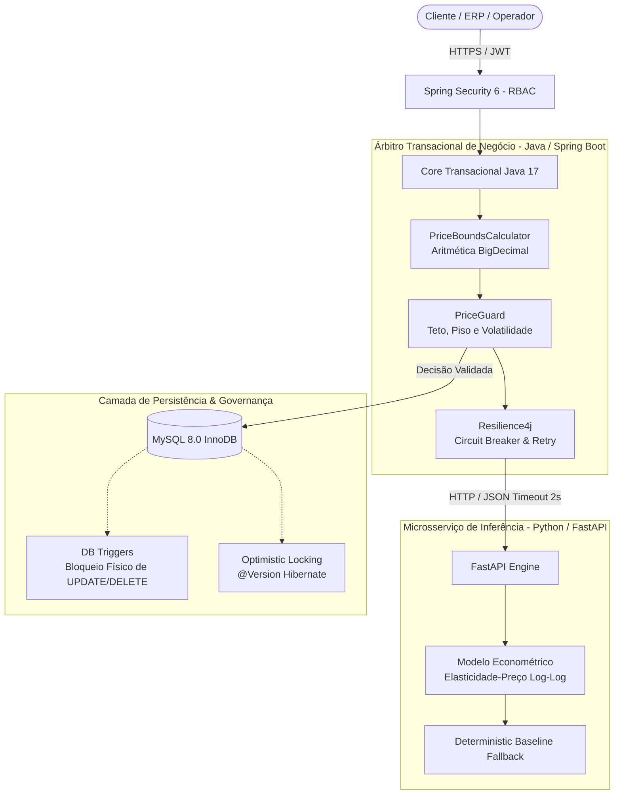
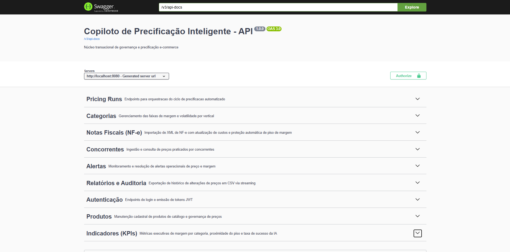
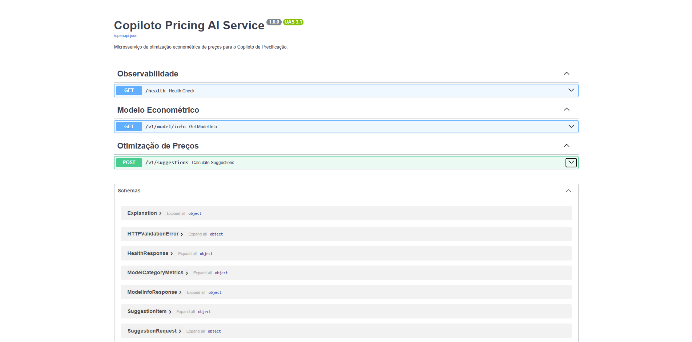
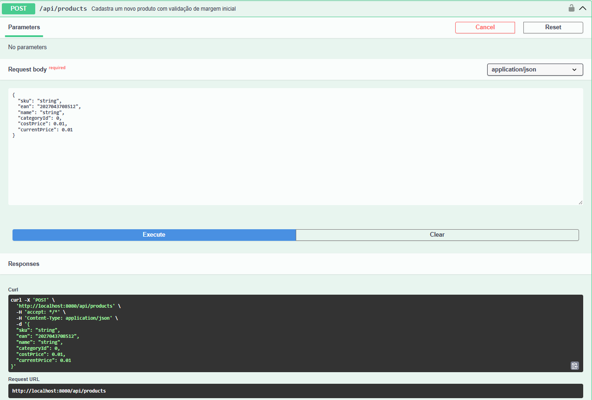
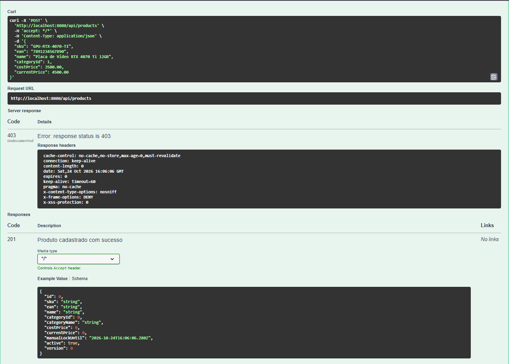
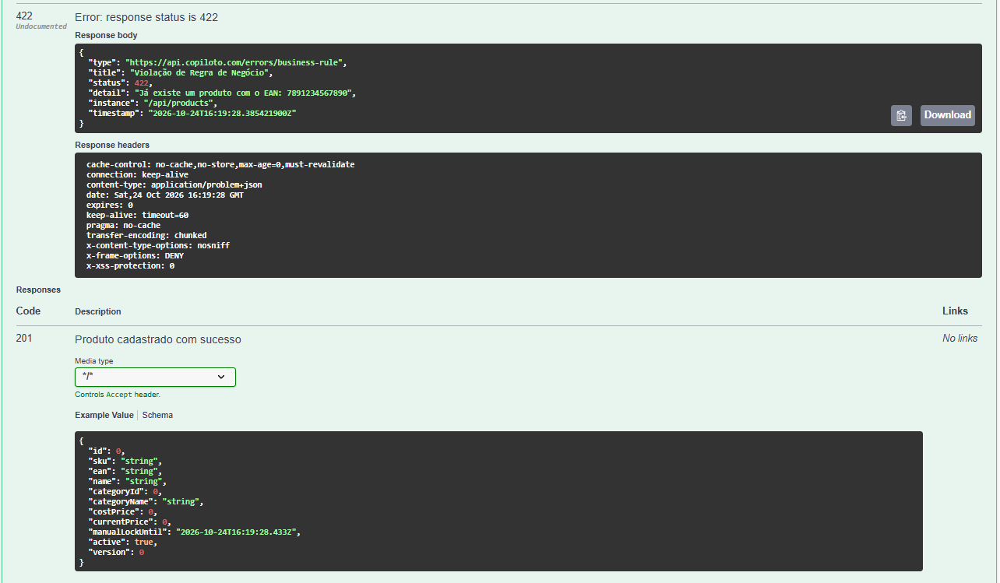
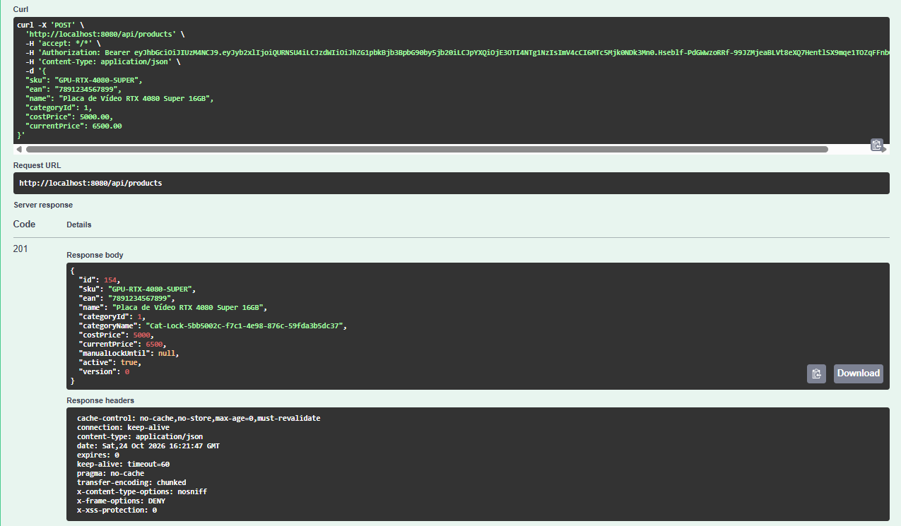

# Copiloto de Precificação Inteligente

p align="left">
  
  
  
  
  
  
  
</p>

---

## O Problema & A Solução de Engenharia

No comércio eletrônico de alta rotação (Hardware, Gaming e Consumer Electronics), a precificação baseada em planilhas manuais ou rotinas em lote não auditadas introduz dois riscos severos: **perda de competitividade frente ao mercado** e, mais crítico, **erosão abrupta de margem de contribuição** causada por oscilações na cadeia de suprimentos ou inconsistências de dados.

O **Copiloto de Precificação Inteligente** soluciona essa dor implementando uma **arquitetura híbrida desacoplada e defensiva**:



### Princípios Norteadores da Arquitetura
1. **A IA Analítica Sugere:** Um microsserviço econométrico em Python (FastAPI/Statsmodels) consome o histórico de preços e elasticidade de demanda para sugerir o ponto de maximização de receita. O serviço é puramente *stateless* e isolado.
2. **O Backend Java Decide e Audita:** O core transacional em Java atua como o **árbitro supremo de negócio**. A recomendação da IA **nunca** é gravada diretamente no catálogo. Toda sugestão é interceptada, validada e ajustada por limites matemáticos rígidos de margem (`marginMin`, `marginMax`) e variação temporal máxima permitida (`maxVariationPercent`).
3. **Imutabilidade e Não-Repúdio:** Nenhuma alteração de preço ocorre sem trilha de auditoria. Triggers de banco de dados no MySQL bloqueiam fisicamente instruções `UPDATE` e `DELETE` no histórico, assegurando conformidade contábil estrita.

---

## Contexto Acadêmico e Uso de IA (Transparência Técnica)

Este projeto nasceu como um desafio pessoal para conectar os pontos fundamentais que venho estudando desde o início da minha jornada em Tecnologia: os cursos **CS50x, CS50p e CS50 SQL de Harvard**, o curso Técnico em Desenvolvimento de Sistemas no **SENAI** e a graduação em Sistemas de Computação na **UFF (via CEDERJ)**.

Meu objetivo inicial era unir meus conhecimentos básicos de **Modelagem de Dados (MySQL)**, **APIs REST/CRUD com Java e Spring Boot** (vistos no SENAI) e uma introdução prática a **Modelos de IA em Python** (explorada em um workshop na UFF utilizando Google Colab).

### Engenharia Assistida por IA como Ferramenta de Estudo
Durante o desenvolvimento, utilizei modelos de IA (LLMs) não apenas para acelerar a escrita de código, mas como um **"Tech Lead / Mentor Virtual"** para compreender como sistemas reais do mercado financeiro e de e-commerce lidam com precisão monetária, concorrência e falhas de rede. Com isso, a arquitetura evoluiu além do escopo básico de sala de aula.

Para manter total transparência com recrutadores e avaliadores técnicos sobre o meu momento atual de carreira (nível Estágio/Iniciante), abaixo está a divisão clara entre o que construí com minha base atual e o que foi implementado sob orientação da IA como laboratório de estudo:

* **O que faz parte da minha base atual (Compreensão Sólida):**
  * Lógica de programação e estruturas de dados em Java e Python (base CS50x / CS50p).
  * Construção de APIs REST, entidades JPA, repositórios e operações de CRUD no Spring Boot (base SENAI).
  * Modelagem de banco de dados relacional no MySQL, constraints e consultas SQL (base CS50 SQL e SENAI).
  * Conceito de integração entre microsserviços via HTTP/JSON e noções introdutórias de regressão/IA em Python.
  * Regras de negócio financeiras fundamentais: por que utilizar `BigDecimal` em vez de `double`/`float` para valores monetários e a lógica de limites de margem (piso e teto).

* **O que foi sugerido e guiado pela IA (Em fase de estudo e exploração):**
  * **Containerização e Testes Avançados:** Configuração de `Docker`, `Testcontainers` e testes baseados em propriedades (*Property-Based Testing* com 300k iterações). Ainda estou dando os primeiros passos em testes automatizados e Docker.
  * **Padrões Avançados do Spring e Resiliência:** Uso de `@Transactional(propagation = REQUIRES_NEW)` em beans isolados, controle de concorrência otimista com `@Version` e configuração de *Circuit Breaker/Retry* com `Resilience4j`. Compreendo conceitualmente o problema que eles resolvem no projeto, mas ainda não domino sua configuração avançada sem consulta.
  * **Triggers de Imutabilidade e ADRs:** A formalização de *Architecture Decision Records* (ADRs) e os triggers de bloqueio de `UPDATE`/`DELETE` nas tabelas de auditoria foram co-criados com a IA para simular boas práticas de *Defense in Depth*.

---

## Demonstração Visual & Evidências de Funcionamento

As capturas abaixo registram o comportamento real do ecossistema distribuído em execução integrada via Docker:

### 1. Visão Geral da API Core em Spring Boot (Porta 8080)

> **Evidência OpenAPI 3.0 / Swagger UI:** Demonstra a orquestração modular dos 9 domínios transacionais e analíticos expostos pelo core Java na porta `8080`: `Pricing Runs`, `Categorias`, `Notas Fiscais (NF-e)`, `Concorrentes`, `Alertas`, `Relatórios e Auditoria`, `Autenticação`, `Produtos` e `Indicadores (KPIs)`.

---

### 2. Contrato OpenAPI 3.1 do Microsserviço de IA em FastAPI (Porta 8000)

> **Evidência do Serviço de Inferência Python:** Interface OpenAPI 3.1 do microsserviço econométrico rodando via Uvicorn na porta `8000`. Exibe os endpoints de observabilidade (`/health`), metadados da regressão (`/v1/model/info`) e cálculo de sugestões (`/v1/suggestions`), além dos esquemas validados rigorosamente via Pydantic v2 com tipos monetários em `Decimal`.

---

### 3. Interface Interativa de Gestão de Catálogo

> **Evidência de Documentação Interativa:** Endpoint `POST /api/products` com especificação completa de parâmetros e payload de entrada (`sku`, `ean`, `name`, `categoryId`, `costPrice`, `currentPrice`). A interface sinaliza visualmente a exigência de token Bearer JWT via Spring Security 6.

---

### 4. Governança e RBAC: Bloqueio Defensivo (HTTP 403 Forbidden)

> **Evidência de Segurança Ativa:** Tentativa de cadastro de produto (`Placa de Vídeo RTX 4070 Ti 12GB`) sem cabeçalho de autenticação. O Spring Security 6 intercepta a requisição antes do dispatcher, bloqueando o acesso e aplicando headers de proteção (`x-content-type-options: nosniff`, `x-frame-options: DENY`, `x-xss-protection: 0`).

---

### 5. Tratamento de Erros Padronizado via RFC 7807 (HTTP 422 Problem Detail)

> **Evidência de Validação de Regra de Negócio:** Violação de unicidade de catálogo tratada via padrão **RFC 7807 (`application/problem+json`)**. Ao tentar registrar um produto com o EAN já existente (`7891234567890`), a API retorna status `422 Unprocessable Entity` com payload semântico padronizado contendo `type`, `title`, `detail`, `instance` e `timestamp` em nanossegundos UTC.

---

### 6. Transação Concluída com Sucesso e Concorrência Otimista (HTTP 201 Created)

> **Evidência de Persistência e Controle de Concorrência:** Requisição autenticada com sucesso (`Authorization: Bearer <JWT>`) cadastrando o item `GPU-RTX-4080-SUPER` (EAN `7891234567899`). O backend responde com `HTTP 201 Created`, resolvendo a categoria dinamicamente e registrando `"version": 0`, comprovando o funcionamento do controle de concorrência otimista via `@Version` do JPA/Hibernate.

---

## Decisões Arquiteturais Relevantes (ADRs)

Para garantir transparência técnica sobre o design do sistema, as decisões críticas foram formalizadas em registros de arquitetura:

* **[ADR-001: Aritmética Monetária e Janela Subcentavo](./docs/adr/ADR-001-aritmetica-monetaria-e-janela-subcentavo.md)**  
  Uso exclusivo de `java.math.BigDecimal` com arredondamento `RoundingMode.HALF_UP` na precificação final e tratamento determinístico de janelas subcentavo (onde o piso de margem é matematicamente inalcançável por frações de centavo).
* **[ADR-002: Triggers de Imutabilidade no MySQL 8.0](./docs/adr/ADR-002-triggers-de-imutabilidade-auditoria.md)**  
  Garantia de integridade forense através de triggers nativas de banco de dados que emitem `SIGNAL SQLSTATE '45000'` impedindo operações de `UPDATE` e `DELETE` nas tabelas `price_history` e `competitor_price`.
* **[ADR-003: Isolamento Transacional de Auditoria](./docs/adr/ADR-003-transacoes-isoladas-em-auditoria.md)**  
  Configuração de `@Transactional(propagation = Propagation.REQUIRES_NEW)` em componentes isolados para assegurar que falhas parciais em produtos não revertam gravações de logs essenciais de precificação.
* **[ADR-004: Resiliência na Integração HTTP Core ↔ IA](./docs/adr/ADR-004-resiliencia-integracao-ia.md)**  
  Implementação de Circuit Breaker com Resilience4j: timeout rígido de 2.000 ms, retry exponencial para erros de transporte e degradação suave com fallback determinístico (regra de markup padrão) quando o serviço de IA estiver indisponível.

> *Aviso sobre Modelagem Preditiva:* O microsserviço econométrico em Python utiliza dados sintéticos calibrados de histórico de transações e concorrência para estimar a elasticidade-preço, servindo como ambiente funcional de simulação econométrica.

---

## Roadmap e Status de Execução (11/11 Concluídas)

- [x] **Milestone 1: Fundação & Infraestrutura**  
  *Setup Maven multi-profile, Docker Compose com MySQL 8.0, Spring Boot Actuator e baseline estruturado do Flyway.*
- [x] **Milestone 2: Modelagem Relacional & Integridade de Dados**  
  *DDL completo, constraints de domínio (`CHECK`, `UNIQUE`, `FKs`), triggers de imutabilidade e suíte de testes com Testcontainers.*
- [x] **Milestone 3: Domínio Puro de Precificação**  
  *Motor central `PriceBoundsCalculator` e `PriceGuard` com `BigDecimal`, arredondamento financeiro e suíte de testes baseados em propriedades com 300.000 iterações (jqwik).*
- [x] **Milestone 4: Catálogo de Produtos & Autenticação RBAC**  
  *Mapeamento JPA com controle otimista (`@Version`), CRUD completo de produtos/categorias, Spring Security 6 com JWT stateless e OpenAPI/Swagger.*
- [x] **Milestone 5: Sobrescrita Manual, Auditoria & Alertas por Eventos**  
  *Endpoints de override, trava temporária (`manual_lock_until`), eventos assíncronos (`PriceChangedEvent`) e disparo de alertas operacionais.*
- [x] **Milestone 6: Ingestão de Preços de Concorrentes**  
  *Strategy Pattern para ingestão em lote de mercado via upload de arquivo CSV multipart e endpoint REST JSON.*
- [x] **Milestone 7: Módulo de IA: Dados Sintéticos & Modelo Econométrico**  
  *Geração reproduzível de dados de vendas/concorrência com seed fixa e regressão linear múltipla log-log para cálculo de elasticidade da demanda.*
- [x] **Milestone 8: Serviço FastAPI de Inferência**  
  *Microsserviço Python stateless, validação de contratos com Pydantic v2 (valores decimais estritos em string) e medição de latência p95 < 500 ms.*
- [x] **Milestone 9: Integração Resiliente Java ↔ IA**  
  *Orquestrador de ciclos (`PricingRunService`), Resilience4j (timeout de 2s, retry, circuit breaker) e processamento transacional isolado.*
- [x] **Milestone 10: Relatórios de Auditoria & Indicadores (KPIs)**  
  *Streaming de exportação CSV de histórico com consumo de memória O(1), consultas SQL analíticas nativas e parser de NF-e (XML).*
- [x] **Milestone 11: Orquestração Completa, CI/CD & DoD Final**  
  *Docker Compose multi-stage build unificado, pipeline de integração contínua no GitHub Actions, homologação final dos ADRs e DoD completo.*

---

## Stack Tecnológica

| Camada | Tecnologia | Propósito no Ecossistema |
| :--- | :--- | :--- |
| **Core Transacional** | Java 17 LTS | Regras de negócio, imutabilidade com `records` e precisão financeira via `BigDecimal`. |
| **Framework Web Core** | Spring Boot 3.3+ | Injeção de dependências, JPA/Hibernate, Spring Data e documentação OpenAPI. |
| **Segurança & RBAC** | Spring Security 6 + JWT | Autenticação stateless com tokens Bearer e controle fino de autorização por perfil. |
| **Microsserviço IA** | Python 3.11 & FastAPI | Inferência econométrica de elasticidade de preço, servida com ASGI de alta performance. |
| **Modelagem Preditiva** | Statsmodels & NumPy | Regressão OLS logarítmica com estimativa de sensibilidade de demanda. |
| **Resiliência HTTP** | Resilience4j | Circuit Breaker, Retry e Time Limiter isolando a chamada ao microsserviço de IA. |
| **Banco de Dados** | MySQL 8.0 (InnoDB) | Persistência ACID, constraints relacionais e integridade física via triggers. |
| **Database Migrations**| Flyway 10.x | Versionamento evolutivo e determinístico de DDL e DML. |
| **Testes de Integração**| Testcontainers & Failsafe | Subida programática de containers reais MySQL durante a fase de build. |
| **Testes de Propriedade**| jqwik | Geração de 300.000 cenários randômicos para validação de limites monetários. |
| **Orquestração Local** | Docker & Docker Compose | Provisionamento em 1 comando de toda a malha de microsserviços e banco. |

---

## Quickstart

### Pré-requisitos
* **Docker** e **Docker Compose** instalados e em execução.
* *(Opcional)* Java 17+ e Maven caso queira executar o backend fora de containers.

### 1. Clonar o repositório
```bash
git clone https://github.com/EriqueGuida/pricing-copilot.git
cd pricing-copilot
```

### 2. Subir todo o ecossistema com Docker Compose
O comando abaixo compila o backend Java multi-stage, constrói a imagem do serviço de IA em Python e provisiona o MySQL com migrations automáticas via Flyway:

```bash
docker compose up --build -d
```

### 3. Verificar status dos containers
```bash
docker compose ps
```

| Serviço | Container | Porta Externa | Descrição |
| :--- | :--- | :--- | :--- |
| **copiloto-mysql** | MySQL 8.0 | `3307` | Banco relacional com migrações Flyway e triggers |
| **copiloto-ai** | FastAPI | `8000` | Serviço econométrico de elasticidade de demanda |
| **copiloto-core** | Spring Boot | `8080` | Núcleo transacional, auditoria e motor de regras |

---

## Acesso às Interfaces e Documentação Interativa

Com os containers em execução, acesse os consoles Swagger disponíveis no seu navegador:

* **Swagger UI (Backend Java Core):**  
  [`http://localhost:8080/swagger-ui/index.html`](http://localhost:8080/swagger-ui/index.html)
* **Swagger UI (Microsserviço de IA - FastAPI):**  
  [`http://localhost:8000/docs`](http://localhost:8000/docs)
* **Health Check do Spring Boot Actuator:**  
  [`http://localhost:8080/actuator/health`](http://localhost:8080/actuator/health)

---

## Credenciais de Demonstração (Controle de Acesso RBAC)

O sistema inicializa automaticamente três usuários padrão via seed de banco com privilégios distintos:

| Perfil (Role) | E-mail de Acesso | Senha Padrão | Permissões Principais |
| :--- | :--- | :--- | :--- |
| **ADMIN** | `admin@pricingcopilot.com` | `admin123` | Acesso irrestrito: CRUD de produtos, categorias, orquestração de runs e overrides. |
| **OPERATOR** | `operator@pricingcopilot.com` | `operator123` | Consulta e atualização operacional de preços e ingestão de concorrência. |
| **EXECUTIVE** | `executive@pricingcopilot.com` | `executive123` | Visualização de relatórios analíticos, KPIs de margem e exportação de auditoria. |

### Como Autenticar no Swagger UI (Core Java)
1. Acesse o endpoint `POST /api/auth/login` no Swagger UI do Core (`http://localhost:8080/swagger-ui/index.html`).
2. Envie o payload de autenticação com o e-mail e senha desejados:
   ```json
   {
     "email": "admin@pricingcopilot.com",
     "password": "admin123"
   }
   ```
3. Copie o valor do campo `"token"` retornado na resposta.
4. Clique no botão verde **Authorize** no topo superior direito da página do Swagger, insira o token no formato `Bearer <SEU_TOKEN>` e clique em **Authorize**. Todas as requisições subsequentes incluirão o cabeçalho de autorização.

---

## Execução de Testes Automatizados

Para executar localmente a suíte completa de testes (unitários, testes baseados em propriedades com `jqwik` e testes de integração com `Testcontainers` subindo um container MySQL real):

```bash
./mvnw clean verify
```

Para executar os testes do microsserviço Python com `pytest`:
```bash
docker compose exec copiloto-ai pytest
```

---

## Documentação Técnica Adicional

* **[Especificação Técnica e PRD Oficial (Master Doc)](./docs/SPECIFICATION.md)**: Fórmulas matemáticas completas, modelos de banco, matriz de riscos e requisitos de sistema.
* **[Diretório de ADRs (Architecture Decision Records)](./docs/adr/)**: Registro formal de decisões técnicas fundamentadas.

---

**Autor:** Erique Guida  
**Repositório:** [https://github.com/EriqueGuida/pricing-copilot](https://github.com/EriqueGuida/pricing-copilot)